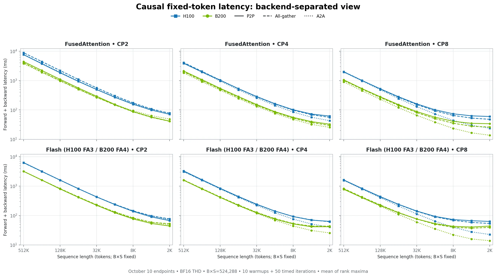
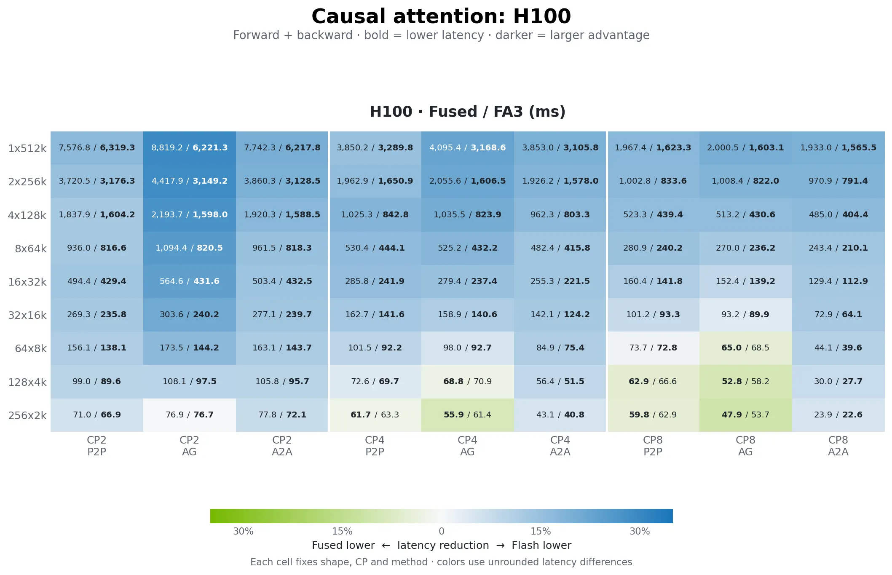
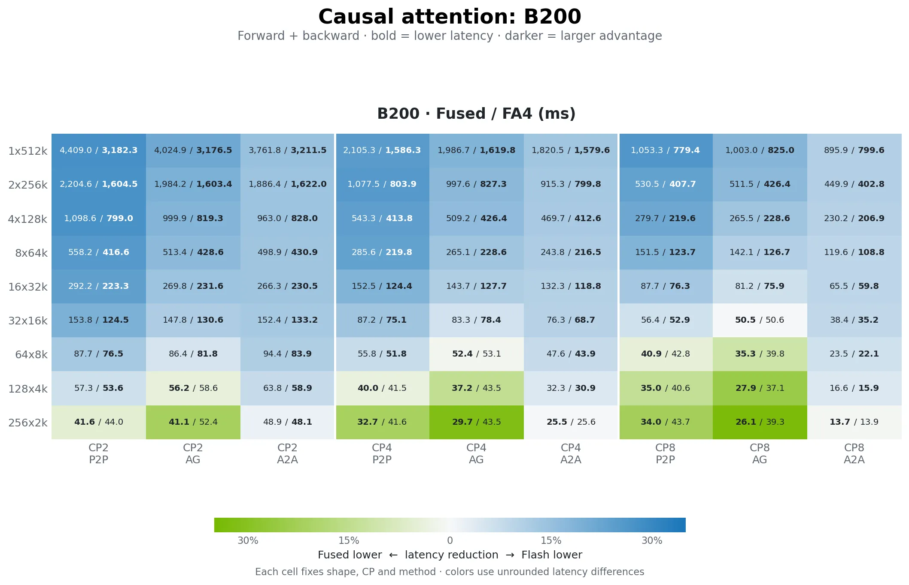
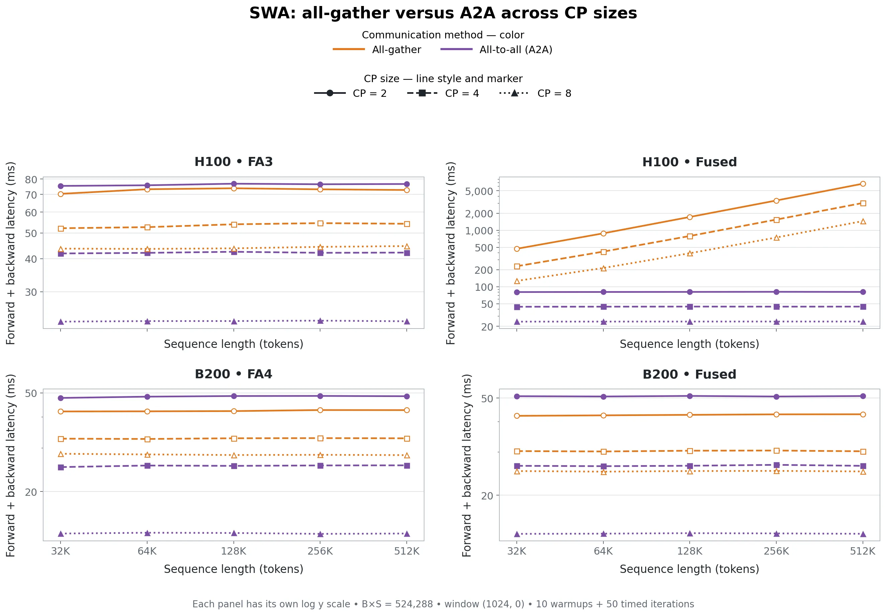

# Choosing Faster Context-Parallel Attention Paths

Choosing a fast context-parallel (CP) attention configuration means selecting
the backend, communication method, and CP size together. These H100 and B200
benchmarks show how workload shape and attention pattern guide that choice,
using complete forward-plus-backward attention latency as the objective.

## What we measured

All figures derive from forward-plus-backward attention latency; the captions
define each comparison and ratio.

| Dimension | Configuration |
| --- | --- |
| Inputs | BF16 packed THD; 32 query / 8 key-value heads; head dimension 128; no dropout or gaps |
| Workload | `B*S=524288` tokens; uniform sequences, with batch size adjusted to keep tokens fixed |
| Causal sweep | Nine shapes: `1x512k` through `256x2k`, halving sequence length each step; `k=1024` |
| Sliding-window attention (SWA) | First five shapes, through `16x32k`; causal window `(1024,0)` |
| Parallelism | CP-only eager execution on 2, 4, or 8 GPUs; P2P, all-gather, A2A; SWA excludes P2P |
| Timing | 10 warmups, then 50 iterations; mean of per-iteration rank-maximum latency; no CUDA graphs |

The [444 endpoint values](results/context_parallel/endpoints_20261116.csv)
use TE `5d4673da00226be3772cdb135db4cdd0e7b8edeb`, CUDA 13.4, cuDNN 9.27/frontend
1.30, NCCL 2.32.3, and PyTorch 2.15 development builds. Fused means cuDNN
FusedAttention. Flash is FA3 on H100; B200 uses FA4 b11/DSL 4.4.2 for causal
and b33/DSL 4.8 for SWA. These results describe the listed versions;
remeasure backend choices when the software changes.

## Start with the actual shape

At fixed token count, shorter sequences reduce the leading dense-attention
work term, `B*S²`. Latency generally falls; several P2P and all-gather curves
flatten at short sequences especially when CP Size >= 4, which is due to
shrinking attention work that exposes communication costs.
Refer to this graph to find out the general workload size and their expected
performance across backend, communication types and GPUs.



*Figure 1. Absolute causal latency. Sequence length decreases left to right;
both axes are logarithmic. Color identifies hardware, line style identifies
communication. The Flash row changes both GPU and implementation: H100 FA3
versus B200 FA4. Colors are local to each figure's legend.*

## Choose backend and communication together

First ask which backend is faster within a chosen communication method.
In Figure 2, rows are workload configs and each column fixes both CP size and method.
Cell colors show the direction and size of the latency difference.





*Figure 2. Cells show Fused / Flash latency in ms at fixed GPU, shape, CP,
and communication method; bold marks the lower value. Green favors Fused,
blue favors Flash. Both panels share a gradient for
`100*(slower-faster)/slower`, calculated before rounding.*

For H100 CP8 `256x2k`, Fused is faster than FA3 when both use P2P;
FA3 is faster than Fused when both use A2A.
The preferred backend changes with the communication method. Figure 3 asks
the complementary question: which method is fastest for each backend?


*Figure 3. Each dot is attention latency divided by the fastest method at
fixed GPU/backend/shape/CP; 1× is best. Row labels give that baseline in ms.
CP columns use different x-axis ranges; use numeric ratios for comparisons
across columns. Compare the printed baseline milliseconds for the same GPU
and shape to select among backends or CP sizes.*

In that H100 example, A2A is fastest for both backends, and FA3 has the lower
A2A latency. Combining the comparisons selects FA3/A2A. Across the measured
causal grid, FA3 supplies the best joint choice for every H100 shape/CP tuple.
B200's Fused joint wins occur at `256x2k`; its CP4/CP8 A2A differences are small.

A2A is a strong first candidate at causal CP4/CP8, especially for short
shapes. At CP2, method ordering changes with shape, backend, and hardware.
Use these patterns to prioritize the supported combinations to benchmark.
If the fastest method is unavailable, Figure 3 shows the next supported option
and its latency penalty at the same GPU/backend/shape/CP.

The benchmarked pure-A2A path shards heads: CP size must divide both local
query and key/value head counts (after any tensor parallelism), so our
32-query/8-KV-head setup caps this path at CP8.

## Choose communication for sliding-window attention

With a fixed window and token count, leading attention work is approximately
constant across these shapes. Most SWA paths are nearly flat; H100 Fused
all-gather is the exception: latency grows strongly with
sequence length, while its A2A path stays nearly flat. Compare communication
methods within each hardware/backend panel to build the SWA shortlist.



*Figure 4. Orange/open markers denote all-gather; purple/filled markers denote
A2A. Line styles and marker shapes identify CP size. Sequence length increases
left to right. Each panel has its own logarithmic y scale; use its labeled
milliseconds when reading latency.*

At SWA CP2, all-gather is lower for H100 FA3 and both B200 backends; H100
Fused instead favors A2A. At CP4/CP8, A2A is lower in all four scopes.

## A small selection loop

1. Fix the workload and target environment: mask/window, shape, precision,
   layout, heads, GPU, and software versions.
2. For each feasible CP size, compare supported **backend × communication**
   combinations, using Figures 2–3 and 4 to prioritize candidates.
3. Choose by absolute forward-plus-backward latency. Then evaluate that
   configuration in the full training workload and resource budget.
4. Verify outputs and gradients; repeat close comparisons. Benchmark additional
   configurations directly on the target environment.

## Run one benchmark

This runs the `64x8k` BF16 THD training case with FusedAttention, CP8 and A2A:

```bash
NVTE_CP_BENCH_ONLY=1 NVTE_NVTX_ENABLED=0 \
torchrun --standalone --nproc-per-node=8 \
  tests/pytorch/attention/run_attention_with_cp.py \
  dtype=bf16 model=uniform_64x8k qkv_format=thd \
  kernel_backend=FusedAttention cp_comm_type=a2a \
  thd_seqlen_pattern=max benchmark=50 log_level=WARNING
```

`CP_BENCH_RESULT` reports per-iteration rank maxima and their mean. Input
construction, synchronization before timing, and result reduction are excluded.
Aliases are in `tests/pytorch/attention/benchmark_cp.py`; benchmark mode here
supports FP16/BF16. See
[Transformer Engine PR #3582](https://github.com/NVIDIA/TransformerEngine/pull/3582).
