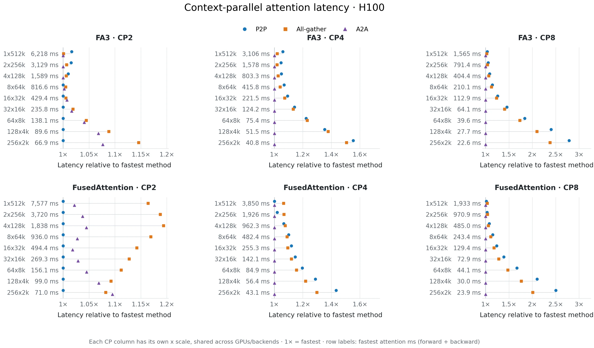
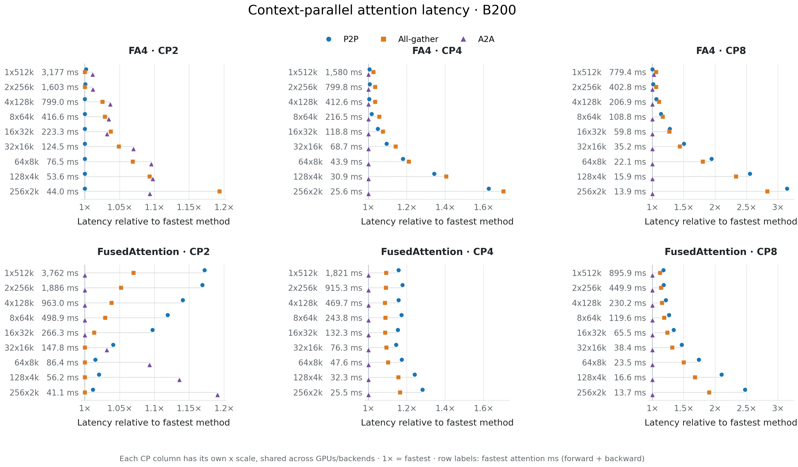

# Choosing Faster Context-Parallel Attention Paths

Choosing a fast context-parallel (CP) attention configuration means selecting
the backend, communication type (`cp_comm_type`), and CP size together. These H100 and B200
benchmarks show how workload shape and attention pattern guide that choice,
using complete forward-plus-backward attention latency as the objective.

Context parallelism in Transformer Engine is evolving; these results describe
the recorded configurations and software versions.

## What we measured

All figures derive from forward-plus-backward attention latency; the captions
define each comparison and ratio.

| Dimension | Configuration |
| --- | --- |
| Inputs | BF16 packed THD; 32 query / 8 key-value heads; head dimension 128; no dropout or gaps |
| Workload | `B*S=524288` tokens; uniform sequences, with batch size adjusted to keep tokens fixed |
| Causal sweep | Nine shapes: `1x512k` through `256x2k`, halving sequence length each step; `k=1024` |
| Sliding-window attention (SWA) | First five shapes, through `16x32k`; causal window `(1024,0)` |
| Parallelism | CP-only eager execution on 2, 4, or 8 GPUs; P2P, all-gather, A2A; SWA excludes P2P |
| Timing | 10 warmups, then 50 iterations; mean of per-iteration rank-maximum latency; no CUDA graphs |

The [collected benchmark values](results/context_parallel/endpoints_20261116.csv)
use TE `5d4673da00226be3772cdb135db4cdd0e7b8edeb`, CUDA 13.4, cuDNN 9.27/frontend
1.30, NCCL 2.32.3, and PyTorch 2.15 development builds. Fused means cuDNN
FusedAttention. Flash is FA3 on H100; B200 uses FA4 4.0.0b11 / CuTe DSL 4.4.2
for causal and FA4 4.0.0b33 / CuTe DSL 4.8.0 for SWA.

## Table of Contents

1. [Workload size for benchmarks](#workload-size-for-benchmarks)
2. [Performance scaling with workload size](#performance-scaling-with-workload-size)
3. [Choosing Backend](#choosing-backend)
4. [Choosing Communication Type](#choosing-communication-type)
5. [Sliding-window attention](#choose-communication-for-sliding-window-attention)
6. [Summary of CP attention backend and comm type selection](#summary-of-cp-attention-backend-and-comm-type-selection)
7. [Run one benchmark](#run-one-benchmark)

## Workload size for benchmarks

The causal benchmarks range from one 512K-token sequence (`1x512k`) to
256 sequences of 2K tokens each (`256x2k`), covering nine long-to-short
sequence shapes. Every shape contains 524,288 tokens: batch size doubles
as sequence length halves. Although token count stays fixed, shorter sequences
reduce the leading dense-attention work term, `B*S²`.

## Performance scaling with workload size

Figure 1 gives the absolute latency range across sequence shapes, backends,
communication types, and GPUs.

Inferences:

1. At a fixed total token count, causal attention latency generally falls as
   sequences get shorter.
2. Several P2P and all-gather curves flatten at short sequences, especially
   at CP4 and CP8. One possible explanation is that communication costs
   become more visible as attention work shrinks.
3. For a few cases, it was observed that A2A communication type on H100 performed better than P2P and AllGather on B200. This indicates potential optimization opportunities.


*Figure 1. Absolute causal attention latency. Sequence length decreases left to right;
both axes are logarithmic. Color identifies hardware, line style identifies
communication. The Flash Attention row changes both GPU and implementation: H100 FA3
versus B200 FA4. Colors are local to each figure's legend.*

## Choosing Backend

Figure 2 compares every causal backend pair. Read it as:

```text
For each GPU and sequence shape [1x512k -> 256x2k]:
   For CP size [2, 4, 8]:
      For communication type [P2P, AG, A2A]:
         Compare Fused Attention vs Flash Attention latency
```

Rows are sequence shapes and each column fixes both CP size and communication type.
Cell colors show the direction and size of the latency difference.

Inferences:

1. For A2A communication type, Flash Attention beats Fused Attention for all workloads and CP sizes on H100 while on B200, Fused Attention catches up for shorter sequences.
2. Similar trend is observed for P2P and AG where Flash is better for larger sequences across CP sizes but Fused catches up and eventually beats Flash for smaller sequences.
3. The catch-up and reversal trend is more pronounced for AG communication type and B200 GPUs.

For P2P and AllGather, the crossover where Fused becomes faster moves toward
longer sequences as CP size increases. On B200, this crossover appears
already at CP2 and at longer sequences than on H100. The crossover depends
on GPU, CP size, and communication type (Figure 2).


*Figure 2. Cells show Fused / Flash latency in ms at fixed GPU, shape, CP,
and communication type; bold marks the lower value. Green favors Fused,
blue favors Flash. Both panels share a gradient for
`100*(slower-faster)/slower`, calculated before rounding.*

## Choosing Communication Type

For H100 CP8 `256x2k`, Fused is faster than FA3 when both use P2P;
FA3 is faster than Fused when both use A2A.
The preferred backend changes with the communication type. Figure 3 asks
the complementary question: which communication type is fastest for each backend?

Inferences:

1. Although A2A/Flash Attention combination seems the winning combination, **A2A is limited by number of heads/groups and isn't always applicable**.
   For the benchmarked pure-A2A path, CP size must divide both local query
   and key/value head counts after tensor parallelism. The benchmark's
   32-query/8-KV-head configuration caps this path at CP8.
2. If A2A isn't applicable, then Fused attention is more appealing for shorter sequences and large CP sizes.
3. While choosing b/w P2P and AllGather, there are more nuances:
   The following comparisons are within the indicated backend:

   - For larger sequences, with FlashAttention:

     - CP = 2, AllGather is faster for a couple long sequence length configs but P2P quickly takes over for both H100 and B200.
     - CP = 4/8, AllGather is faster than P2P on H100 and vice-versa on B200 (64K–512K sequences).
   - Within Fused Attention at CP2, P2P is faster than AllGather on H100, while AllGather is faster on B200.
   - For the sequence-length ranges where Fused Attention wins (for the given GPU, CP size, and communication type; see Figure 2):

     - CP = 4/8, AllGather is faster than P2P on both H100 and B200.





*Figure 3. Each dot is attention latency divided by the lowest measured latency
across communication types at fixed GPU/backend/shape/CP; 1× is best.
Row labels give that baseline in ms.
CP columns use different x-axis ranges; use numeric ratios for comparisons
across columns. Compare the printed baseline milliseconds for the same GPU
and shape to select among backends or CP sizes.*

## Choose communication for sliding-window attention

The SWA benchmarks use causal window `(1024,0)` and the five shapes from
`1x512k` through `16x32k`, retaining the same BF16 THD inputs and head
configuration. With a fixed window and token count, leading attention work
is approximately constant across these shapes. Most curves are nearly flat;
H100 Fused all-gather is the exception: latency grows strongly with sequence
length, while its A2A path stays nearly flat. There are known optimization
opportunities in AG SWA kernel path.


*Figure 4. Orange/open markers denote all-gather; purple/filled markers denote
A2A. Line styles and marker shapes identify CP size. Sequence length increases
left to right. Each panel has its own logarithmic y scale; use its labeled
milliseconds when reading latency.*

Inferences:

1. With A2A as the communication type, the workload scales quite well from CP2 to CP8.
2. At SWA CP2, all-gather is lower for H100 FA3 and both B200 backends; H100
   Fused instead favors A2A.
3. At CP4/CP8, A2A is lower in all four scopes.
4. But since A2A isn't universally applicable, AllGather then remains the only valid option.

## Summary of CP attention backend and comm type selection

1. Check A2A eligibility: CP must divide both local query and key/value
   head counts after tensor parallelism. The measured 32-query/8-KV-head
   configuration caps this path at CP8.
2. For causal attention, shortlist A2A with Flash Attention when eligible,
   then compare backend and communication type jointly at the target GPU,
   shape, and CP size (Figures 2–3). With P2P/AllGather, Fused Attention's crossover
   moves toward longer sequences as CP increases and appears already at
   CP2 on B200; use the communication-type-specific range in Figure 2.
3. When A2A is unavailable, compare P2P and AllGather within each backend
   (Figure 3). Within Fused at CP2, H100 favors P2P and B200 favors AllGather.
   At CP4/CP8, AllGather is lower in the sampled Fused-winning ranges;
   Flash's ordering depends on GPU, sequence length, and CP size.
4. For the benchmarked SWA workloads, CP2 favors AllGather except for H100
   Fused, which favors A2A. CP4/CP8 favor A2A for both backends on both GPUs;
   when A2A is ineligible, AllGather remains the supported option (Figure 4).

## Run one benchmark

This runs the `64x8k` BF16 THD training case with FusedAttention, CP8 and A2A:

```bash
NVTE_CP_BENCH_ONLY=1 NVTE_NVTX_ENABLED=0 \
torchrun --standalone --nproc-per-node=8 \
  tests/pytorch/attention/run_attention_with_cp.py \
  dtype=bf16 model=uniform_64x8k qkv_format=thd \
  kernel_backend=FusedAttention cp_comm_type=a2a \
  thd_seqlen_pattern=max benchmark=50 log_level=WARNING
```

`CP_BENCH_RESULT` reports per-iteration rank maxima and their mean. Input
construction, synchronization before timing, and result reduction are excluded.
Aliases are in `tests/pytorch/attention/benchmark_cp.py`; benchmark mode here
supports FP16/BF16.
